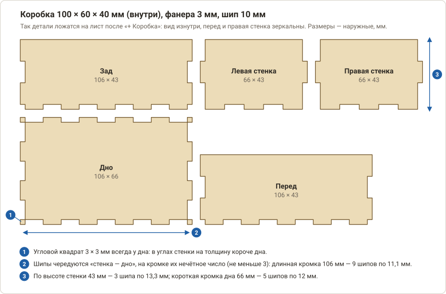
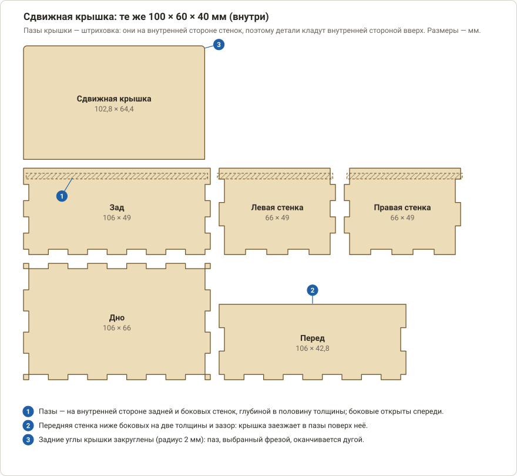

# Изготовление коробки с шипами

Как из листа фанеры, МДФ или акрила сделать коробку для самоделки на фрезерном станке (CNC 3018) или лазером:
размеры, пробная коробочка, резка, крышка и сборка. Генератор сам раскладывает детали с соединением «шип-паз» и
добавляет операции резки — здесь всё остальное, от чего зависит, получится ли коробка с первого раза. Поля
генератора описаны в [справочнике](boxes-panels.md#2-коробка-с-шипами), вырезы под разъёмы и ручки — в
[руководстве по приборной панели](front-panel.md).

*Детали коробки 100 × 60 × 40 мм (внутри) после «+ Коробка»: вид изнутри, перед и правая стенка зеркальны.*

[← Назад к README](../README.md) · [Справочник: коробки и панели](boxes-panels.md) · [Приборная панель](front-panel.md) · [Все операции](operations/README.md)

---

## Коротко

1. Измерьте толщину листа штангенциркулем, выберите размеры и крышку.
2. «Станок»: профиль, толщина заготовки, ноль; «Инструменты»: фреза Ø3,175 (или лазер).
3. «Конструктор» → «Коробка с шипами» → **«+ Коробка»**.
4. Сначала вырежьте **пробную коробочку** и подберите «Посадку».
5. Закрепите лист, выставьте ноль, проверьте проход по воздуху и вырежьте.
6. Соберите всухую, потом на клей; сошлифуйте выступившие торцы шипов.

## Содержание

1. [Что понадобится](#1-что-понадобится)
2. [Размеры и материал](#2-размеры-и-материал)
3. [Станок, заготовка и инструмент](#3-станок-заготовка-и-инструмент)
4. [Коробка в PathForge](#4-коробка-в-pathforge)
5. [Пробная коробочка и посадка](#5-пробная-коробочка-и-посадка)
6. [Фрезерный станок: закрепление и резка](#6-фрезерный-станок-закрепление-и-резка)
7. [Лазер: ширина реза и режимы](#7-лазер-ширина-реза-и-режимы)
8. [Крышка](#8-крышка)
9. [Если детали не помещаются в поле станка](#9-если-детали-не-помещаются-в-поле-станка)
10. [Отверстия и вырезы в стенках](#10-отверстия-и-вырезы-в-стенках)
11. [Сборка](#11-сборка)
12. [Если что-то не так](#12-если-что-то-не-так)

---

## 1. Что понадобится

- **Лист материала.** Для коробки по умолчанию (100 × 60 × 40 мм внутри, без крышки) раскладка занимает
  **248 × 114 мм**: берите заготовку от 270 × 135 мм — по 10 мм запаса со всех сторон под ноль и крепление. Точный
  размер раскладки виден на чертеже после «+ Коробка».
- **Материал:** фанера 3–4 мм (берёзовая режется чище хвойной), МДФ, акрил. Прозрачный акрил диодный лазер не берёт —
  для него нужен фрезер или непрозрачный (тёмный) акрил.
- **Инструмент:** фрезер с концевой фрезой Ø3,175 мм (в новом проекте она уже есть как **T1**) или лазер.
- **Штангенциркуль** — толщину листа нужно измерить, а не верить надписи на упаковке. Наждачная бумага P120–P240,
  угольник, малярный скотч.
- **Клей:** столярный ПВА для дерева, фанеры и МДФ; клей-растворитель для акрила. Струбцины или резинки.
- **Фрезер:** жертвенный лист под заготовку и двусторонний скотч. **Лазер:** обдув (air assist) и вытяжка.
- **Безопасность:** очки; при фрезеровании МДФ — пылесос и респиратор (пыль вредна); лазер — вытяжка наружу, от станка
  не отходить. Подробно — в [первом запуске 3018](first-run-3018.md) и [с лазером](first-run-3018-laser.md).

## 2. Размеры и материал

**Толщина.** «Фанера 3 мм» бывает 2,7–3,2 мм. Измерьте лист в 3–4 местах и впишите среднее в поле **«Толщина»**:
от неё зависят глубина пазов и посадка шипов. Если толщина по листу гуляет на 0,2 мм и больше, торцы шипов не будут
вровень со стенкой — их сошлифуют после склейки.

**Размеры.** Включите **«Внутренние размеры»** и задайте то, что должно поместиться внутрь: плату, разъёмы, батареи и
3–5 мм запаса на провода. Наружные размеры генератор прибавляет сам:

| | Без крышки и накладная | Сдвижная |
|---|---|---|
| Ширина (X) и глубина (Y) снаружи | внутри + 2 толщины | внутри + 2 толщины |
| Высота снаружи | внутри + 1 толщина (дно) | внутри + 3 толщины (дно, крышка и борт над ней) |

Для 100 × 60 × 40 мм и листа 3 мм получится **106 × 66 × 43 мм** (без крышки) или **106 × 66 × 49 мм** (сдвижная).
Накладная крышка лежит сверху на стенках, поэтому полная высота закрытой коробки — высота стенок плюс толщина крышки
(43 + 3 = 46 мм).

**Ширина шипа.** Обычно 2–4 толщины (для листа 3 мм — 6–12 мм). Генератор подгоняет её так, чтобы на каждой кромке
было нечётное число шипов, не меньше трёх: на кромке 106 мм при «Шип» 10 получится 9 шипов по 11,1 мм. Шип должен быть
не уже толщины листа (иначе PathForge предупредит, что шипы будут ломаться) и не уже диаметра фрезы — иначе она не
пройдёт по пазу между шипами. Для фрезы Ø3,175 берите шип 6 мм и шире.

**Минимальные размеры.** Каждый наружный размер — не меньше четырёх толщин, а высота коробки со сдвижной крышкой — не
меньше шести. Иначе PathForge ответит «Коробка: размеры слишком малы для такой толщины материала» и деталей не
построит.

**Крышка.**

| Крышка | Когда брать | Что добавится в раскладку |
|---|---|---|
| **Без крышки** | Лоток, ящик, корпус, у которого крышкой служит отдельная панель | Только 5 деталей: дно и четыре стенки |
| **Накладная** | Простая съёмная крышка | «Крышка» (по наружному размеру) и «Вкладыш крышки» — его приклеивают снизу, чтобы крышка не съезжала |
| **Сдвижная (в пазах)** | Крышка без винтов и петель | «Сдвижная крышка», пазы на внутренней стороне задней и боковых стенок, передняя стенка ниже |

## 3. Станок, заготовка и инструмент

1. Вкладка **«Станок»** → профиль → **«Применить»**: для фрезера **«CNC 3018 Pro (шпиндель 775)»**, для лазера
   **«CNC 3018 Pro (лазер 5 Вт)»** или **«(лазер 10 Вт)»**. От профиля зависит, какие операции создаст «+ Коробка»:
   при лазерном профиле — лазерные, иначе — фрезерные.
2. В группе **«Заготовка и ноль»**: **«Толщина заготовки»** — измеренная толщина листа, **«Ноль X/Y»** — «Левый
   нижний угол», **«Ноль Z»** — «Верх заготовки».
3. **«Инструменты»:**
   - фрезер — **T1** «Дерево, фанера: Фреза 1-заходная Ø3,175» есть в новом проекте; для МДФ возьмите пресет
     «МДФ: Фреза 1-заходная Ø3,175», для акрила — «Акрил: Фреза 1-заходная Ø3,175 (O-flute)». Генератор берёт самую
     крупную концевую фрезу диаметром до 3,2 мм, поэтому лишних фрез такого размера в списке лучше не держать — а
     после «+ Коробка» проверьте инструмент в созданной операции;
   - лазер — добавьте «Лазер: Лазерный модуль 5 Вт» или «10 Вт». **Диаметр** инструмента — размер пятна: из него
     берётся ширина реза по умолчанию (подробнее — [раздел 7](#7-лазер-ширина-реза-и-режимы)).
4. Проверьте «Рабочее поле X, мм» и «Рабочее поле Y, мм»: у профилей 3018 это 300 × 180 мм. По ширине X поля
   генератор укладывает детали рядами.

## 4. Коробка в PathForge

1. **«Конструктор» → «Коробка с шипами».** Для примера: «Ш × Г × В» — 100 × 60 × 40, «Внутренние размеры» включено,
   «Толщина» — измеренная (здесь 3), «Шип» — 10, «Крышка» — «Без крышки», «Посадка» — 0, «Зазор» — 5.
2. **«+ Коробка».** Детали появятся на слое «Коробка» справа от чертежа (в пустом проекте — от нуля), рядами по
   ширине поля станка, и будут выделены. Операции добавятся сами и встанут в конец списка.

Для примера получится:

| Деталь | Размер, мм | Примечание |
|---|---|---|
| Дно | 106 × 66 | по краю шипы и угловые квадраты 3 × 3 мм |
| Перед, Зад | 106 × 43 | одинаковые детали |
| Левая, Правая стенка | 66 × 43 | одинаковые детали |

Вся раскладка — **248 × 114 мм** (на чертеже перед и правая стенка нарисованы зеркально — это вид изнутри, на самих
деталях разницы нет). Количество шипов: на длинной кромке 9 × 11,1 мм, на короткой 5 × 12 мм, по высоте стенки
3 × 13,3 мм. Угловые квадраты 3 × 3 мм всегда принадлежат дну: в углах стенки на толщину короче.

**Какие операции добавились:**

| | Фрезер | Лазер |
|---|---|---|
| Детали | «Коробка»: «Контур», **«Снаружи»**, глубина = толщина + 0,2 мм, врезание рампой, **подрезка углов Dogbone** | «Коробка»: «Лазер», «По линии», 100 %, 300 мм/мин, 2 прохода, обдув, ширина реза **«Детали в размер»** (ширина = пятно лазера) |
| Пазы сдвижной крышки | «Пазы крышки»: «Карман», глубина = половина толщины, врезание рампой | «Пазы крышки»: «Лазер», «Заливка штриховкой», 100 %, 600 мм/мин, 3 прохода |

Пазы идут **перед** деталями: сначала на целых стенках выбираются пазы, потом стенки вырезаются.

**Детали нарисованы изнутри, кладите их внутренней стороной вверх.** Это важно для пазов сдвижной крышки (они на
внутренней стороне) и для отверстий в стенках (там зеркало, см. [раздел 10](#10-отверстия-и-вырезы-в-стенках)).
Листы с одной хорошей стороной (шпон, ламинат, МДФ с плёнкой) кладите **хорошей стороной вниз**: она окажется снаружи
коробки, а зачистка и копоть — на внутренней.

**Проверьте:** на вкладке «Сообщения» нет предупреждений «⚠» (особенно «Программа занимает по Y … мм, а ход станка …
мм» — см. [раздел 9](#9-если-детали-не-помещаются-в-поле-станка)); «3D-симуляция» — все детали вырезаются насквозь, пазы
(если есть) выбраны первыми.

## 5. Пробная коробочка и посадка

Фанера неровная по толщине, лазер режет шире, чем пишет паспорт, а у каждой фрезы свой увод. Поэтому прежде, чем
пускать в дело лист, вырежьте **пробную коробочку** — пять маленьких деталей, на которые уходят минуты и обрезки.

1. Лучше всего — в отдельном проекте: **Файл → Новый проект** (Ctrl+N), на вкладке «Станок» выберите профиль и
   «Применить», впишите толщину заготовки, добавьте нужный инструмент.
2. **«Конструктор» → «Коробка с шипами»:** «Ш × Г × В» — **30 × 30 × 15**, «Внутренние размеры» включено, «Толщина» —
   измеренная, «Шип» — **8**, «Крышка» — «Без крышки», «Посадка» — **0** → **«+ Коробка»**. Для листа 3 мм получится
   коробочка 36 × 36 × 18 мм из пяти деталей (раскладка 200 × 36 мм), по три шипа на каждой кромке.
3. Вырежьте её тем же инструментом и режимом, что пойдут в дело (разделы [6](#6-фрезерный-станок-закрепление-и-резка) и
   [7](#7-лазер-ширина-реза-и-режимы)).
4. Соберите **всухую**, без клея, пальцами. Оцените:

| Как сидит | Что менять |
|---|---|
| Входит от нажима пальцами и не болтается | Хорошо. Если коробку будете клеить — можно чуть свободнее (+0,05) |
| Нужен молоток, фанера трещит | «Посадка» **+0,05…+0,1** |
| Болтается, шипы гуляют | «Посадка» **−0,05**; у лазера сначала проверьте ширину реза ([раздел 7](#7-лазер-ширина-реза-и-режимы)) |
| Торцы шипов выступают над стенкой или западают | Толщина введена неточно: измерьте лист ещё раз |

Положительная «Посадка» расширяет пазы в каждом соединении на её величину (свободнее, под клей), отрицательная —
сужает (натяг). Меняйте по 0,05 мм и вырезайте коробочку заново, пока не получится нужная плотность.

5. Подобранную «Посадку» запишите. Основную коробку делайте в **новом проекте** (Ctrl+N): иначе она встанет справа от
   пробной, а ноль X/Y останется у пробной.

## 6. Фрезерный станок: закрепление и резка

**Закрепление.** У коробки нет перемычек — они остались бы на шипах и мешали сборке, — поэтому вырезанные детали ничто
не держит, кроме крепления листа.

- Жертвенный лист должен быть ровным: фреза идёт на 0,2 мм глубже листа. Если стол «горбатый», выровняйте его
  операцией «Торцовка» ([инструкция](operations/facing.md)).
- Лист — на двусторонний скотч по всей нижней стороне (или малярный скотч на лист и подложку, а между ними капли
  секундного клея). Струбцины и саморезы — **за пределами раскладки**, не ближе 10 мм к деталям.
- Мелкие детали после выреза остаются приклеенными — их потом отрывают шпателем. Саморезами крепите лист только по
  углам.

**Ноль.** X0 Y0 — левый нижний угол раскладки (у «Дна»): «Ноль X/Y берётся от габарита всего чертежа». Фреза идёт
снаружи контура, на радиус дальше, поэтому поставьте ноль в 5–10 мм от кромки листа **внутрь**. Z0 — на верх листа.
Как выставлять ноль и проходить программу «по воздуху» — в [первом запуске 3018](first-run-3018.md), шаги 8–10.

**Режим.** Пресеты — осторожные стартовые значения: «Дерево, фанера: Фреза 1-заходная Ø3,175» — подача 400 мм/мин,
врезание 120, шаг по глубине 1 мм (для листа 3 мм глубина 3,2 мм — четыре прохода); «МДФ» — 450 мм/мин; «Акрил
(O-flute)» — 350 мм/мин, шаг 0,8 мм. На первой коробке не стесняйтесь убавить подачу кнопкой «−10 %» в строке «Подача»
на «Пульте».

- Детали лежат внутренней стороной вверх, наружная — на подложке. Обычная фреза со стружкой **вверх** рвёт верхнюю
  (внутреннюю) сторону и оставляет чистой нижнюю — для коробки это то, что нужно. Если важны обе стороны,
  возьмите пресет со стружкой вниз или компрессионный.
- Акрил: оставьте защитную плёнку на верхней стороне, не поднимайте подачу — фреза должна отводить стружку, а не
  плавить пластик.
- Слушайте станок. Визг, дым, чёрный край — уменьшите подачу; сильный удар — **■ Стоп**.

**После резки.** Дождитесь остановки шпинделя, снимите детали с подложки шпателем. В углах пазов видны круглые «ушки»
подрезки — это нормально, без них шип не вошёл бы в паз. Остатки ворса зачистите наждачкой и ножом, особенно на гранях
шипов.

## 7. Лазер: ширина реза и режимы

Лазер выжигает полоску 0,1–0,3 мм, а шипы подгоняются с точностью в сотые доли миллиметра. Поэтому для коробки важны
**ширина реза** и **режим**. «+ Коробка» ставит ширину реза, равную диаметру инструмента (пятну), — это нижняя граница:
в фанере рез обычно шире.

1. **Фокус** — на поверхности материала, Z0 там же ([фокусировка](first-run-3018-laser.md)).
2. **Режим резки.** В операции «Коробка» стоят 100 %, 300 мм/мин и 2 прохода — это ориентир для модуля 10 Вт. Для
   вашего модуля и фанеры подберите режим [тест-сеткой](operations/laser-test-card.md). Ориентиры для фанеры 3 мм:
   10 Вт — 100 %, 200–300 мм/мин, 1–2 прохода, с обдувом; 5 Вт — 100 %, 150–250 мм/мин, 3–6 проходов.
3. **Ширина реза.** Вырежьте квадрат 20 мм тем же режимом и измерьте: ширина реза = 20 − измеренный размер. Впишите
   её в «Ширина реза, мм» операции «Коробка» (режим «Детали в размер» остаётся). Тогда детали и пазы получатся в
   чертёжный размер, а оставшийся зазор уточнит «Посадка».
4. **Микроперемычки** на коробке обычно не нужны. Если детали проваливаются в соты стола — включите 2 перемычки на
   контур, но помните, что след от них придётся зачистить ножом до сборки.
5. **Пазы сдвижной крышки.** Операция «Пазы крышки» — заливка 100 %, 600 мм/мин, 3 прохода — только ориентир: глубина
   зависит от модуля. Выжгите пробный квадрат с разным числом проходов и подберите такое, при котором глубина равна
   **половине толщины или чуть больше** (для листа 3 мм — 1,5–1,7 мм). Мельче нельзя: крышка не войдёт, глубже —
   только слегка болтаться.
6. **Порядок:** пазы → детали. Он уже такой.
7. После резки протрите детали сухой тряпкой или салфеткой со спиртом, **зачистите наждачкой грани шипов** — копоть
   мешает клею.

## 8. Крышка

**Накладная.** «Крышка» — пластина размером с наружный контур коробки (106 × 66 мм), «Вкладыш крышки» чуть меньше
внутреннего размера (99,6 × 59,6 мм, зазор 0,2 мм со всех сторон). Приклейте вкладыш к крышке снизу **по центру**:
положите крышку внутренней стороной вверх, отмерьте штангенциркулем отступ от кромки (**толщина + 0,2 мм**, у
примера — 3,2 мм) с каждой стороны, нанесите клей, придавите грузом. Клей на кромки вкладыша не наносите — крышка
должна сниматься.

**Сдвижная.** Она заходит спереди: передняя стенка ниже боковых на две толщины и зазор, пазы идут вдоль боковых
стенок и поперёк задней, а у крышки закруглены задние углы — по радиусу фрезы, которой выбраны концы пазов.

*Коробка 100 × 60 × 40 мм со сдвижной крышкой: пазы — штриховка на внутренней стороне стенок.*

- Крышку режьте из **того же листа**: паз рассчитан на толщину листа плюс 0,2 мм зазора (при положительной «Посадке»
  зазор растёт на её величину).
- Сначала соберите коробку всухую и проверьте, что крышка идёт по пазам без заеданий; **клеить крышку нельзя**, а
  пазы нельзя заливать клеем — убирайте его сразу.
- Заедает — потрите пазы и кромки крышки свечой или воском, при необходимости слегка зачистите кромки крышки наждачкой.
- Чтобы крышку удобно было выдвигать, сделайте в ней отверстие под палец: «Конструктор» → «Вырезы для панели» →
  «Круглое отверстие» Ø10–12 мм у переднего края крышки (центр — «По выделению» от контура крышки), потом «Контур» «Внутри»
  — или «Лазер» — для этого отверстия перед операцией «Коробка».

## 9. Если детали не помещаются в поле станка

Генератор укладывает детали рядами по ширине поля X, но по Y раскладка может выйти за поле. Для коробки по умолчанию
(100 × 60 × 40 мм внутри, лист 3 мм):

| Крышка | Раскладка, мм | Ход Y у 3018 — 180 мм |
|---|---|---|
| Без крышки | 248 × 114 | помещается |
| Накладная | 248 × 185 | выше на 5 мм |
| Сдвижная | 248 × 189,4 | выше на 9,4 мм |

В этом случае на вкладке «Сообщения» появится предупреждение «Программа занимает по Y … мм, а ход станка 180 мм».
Крышка (и вкладыш) лежат в верхнем ряду, так что проще всего резать корпус и крышку из **двух заготовок**:

1. Сохраните проект («Файл → Сохранить», Ctrl+S).
2. Выделите рамкой (Shift + протянуть мышью **вправо**) крышку с вкладышем и нажмите **Del**. Они исчезнут с чертежа и из
   операций, а ноль X/Y сместится в левый нижний угол корпуса. Вырежьте корпус.
3. Откройте сохранённый проект («Файл → Открыть проект»), удалите так же детали корпуса и вырежьте крышку: ноль снова
   в левом нижнем углу того, что осталось на чертеже.

Рамку обводите по середине зазора между деталями — она захватит и пазы, выступающие за кромку стенки.

Накладную крышку можно попробовать уложить плотнее автораскладкой — [«Раскладка деталей на листе»](operations/nesting.md)
(«Размер со станка» → «Разложить», шаг поворота 90; для фанеры с рисунком волокон выключите «Поворачивать»). Если не
поместилось — режьте на двух заготовках. **Для сдвижной крышки автораскладка не годится:** контуры пазов боковых стенок
выходят за кромку детали, и «Раскладка» не считает их частью стенки — пазы останутся на старом месте.

## 10. Отверстия и вырезы в стенках

Отверстие под кабель, окно USB, выключатель, вентиляция делаются теми же вырезами, что и на
[приборной панели](front-panel.md) — прямо на нужной стенке в чертеже.

1. Стенки нарисованы **изнутри**: **перед и правая стенка зеркальны**. Нижний край стенки в чертеже — тот, что стыкуется
   с дном. Если смотреть на стенку снаружи, то у передней и правой левый край на чертеже окажется справа. Поэтому
   отсчитывайте положение выреза от нужного края **по чертежу**, а не по готовой коробке; вырез по центру стенки от
   зеркала не зависит.
2. Выделите контур стенки (клик) → «Конструктор» → «Вырезы для панели» → выберите вырез, поправьте размеры →
   **«По выделению»**: центр выреза встанет в центр стенки. Поправьте X и Y числами: сдвиг от центра стенки вправо
   и вверх по чертежу — плюс. Нажмите **«+ Вырез»**.
3. Не ставьте вырез ближе 3–5 мм к кромке стенки, к шипам и (у сдвижной крышки) к пазам — стенка там слабая.
4. Операции: круглые отверстия — «+ Отверстия по спирали», окна — **«+ Контур» «Внутри»** (с подрезкой углов для
   прямоугольных), лазер — «+ Лазер». Эти операции нужно поставить **выше** операции «Коробка» (кнопка ▲): иначе стенка
   будет вырезана до своих отверстий.

**Пример:** USB-C в середине левой стенки 66 × 43 мм на высоте 20 мм от дна. «По выделению» даёт центр стенки (21,5 мм
от дна), значит Y центра выреза = Y центра стенки − 1,5; X — как у центра стенки. Вырез — «USB-C».

## 11. Сборка

1. **Сухая сборка.** Соберите все детали без клея: проверьте, что всё входит, а стенки встают в паз крышки (у
   сдвижной). У коробки без сдвижной крышки перед и зад — одинаковые детали, левая и правая — тоже. У сдвижной крышки
   передняя стенка — та, что ниже.
2. **Клей.** Нанесите ПВА тонкой плёнкой на боковые грани шипов (не на дно паза), вставьте шипы. Порядок: **стенки —
   кольцом, затем дно**. Выступивший клей сразу уберите влажной салфеткой.
3. **Прямой угол.** Пока клей не схватился, замерьте обе диагонали по верху: они должны совпадать (±0,5 мм), иначе
   коробку перекосило. Стяните резинкой или малярным скотчем; струбцины не перетягивайте — фанера слоится.
4. **После высыхания** сошлифуйте выступающие торцы шипов вровень со стенкой (P120, затем P240), скруглите острые
   рёбра. МДФ загрунтуйте — торцы впитывают краску.
5. **Акрил.** Клей-растворитель подают шприцем в стык по линии шипов; перекос исправляйте сразу — схватывает быстро.
   Работайте в перчатках и с проветриванием.
6. **Отделка.** Масло, лак или краска; сдвижную крышку и её пазы покройте воском или парафином (свечой).

## 12. Если что-то не так

| Признак | Что делать |
|---|---|
| Шипы не входят в пазы | Фреза: проверьте, что в операции «Коробка» **«Подрезка углов»** — Dogbone, а не «Нет»; фанера толще введённой — измерьте. Лазер: ширина реза меньше настоящей — измерьте её ([раздел 7](#7-лазер-ширина-реза-и-режимы)). Во всех случаях — «Посадка» +0,05…+0,1 и пробная коробочка |
| Шипы болтаются | «Посадка» −0,05. Лазер: ширина реза введена больше настоящей |
| Шипы ломаются при сборке | Шип уже толщины листа: увеличьте «Шип» или размеры коробки; волокна фанеры вдоль шипа слабее — разверните лист или возьмите «Шип» шире |
| Шипы выступают или не доходят до края | Толщина введена неточно; выступившие торцы сошлифуйте |
| Детали получились не того размера, все | Шаги станка (калибровка, [первый запуск](first-run-3018.md), шаг 6) или ширина реза у лазера |
| Не прорезало насквозь | Фрезер: проверьте Z0, толщину листа и жертвенный стол (глубина — толщина + 0,2 мм). Лазер: больше проходов или меньше скорость, фокус, обдув |
| Деталь сорвало, «пожевало» | Крепление: скотч по всей площади; при необходимости — меньше подача |
| Кромка чёрная, горит | Лазер: обдув; меньше проходов на 100 % вместо многих медленных; зачистите шипы |
| «Программа занимает по Y … мм, а ход станка …» | Раскладка не влезает в поле станка: [раздел 9](#9-если-детали-не-помещаются-в-поле-станка) |
| «Коробка: размеры слишком малы для такой толщины материала» | Наружный размер — не меньше четырёх толщин (у сдвижной крышки высота — не меньше шести) |
| «Фреза не помещается»: между шипами не режется | Шип уже диаметра фрезы: увеличьте «Шип» или возьмите фрезу тоньше |
| Крышка не входит в пазы | Лазер: пазы мельче половины толщины — больше проходов в «Пазы крышки»; фрезер: проверьте глубину кармана (половина толщины); «Посадка» +0,05 |
| Крышка болтается, заедает слишком мало | «Посадка» меньше: у сдвижной крышки зазор — 0,2 мм плюс положительная «Посадка» |
| Автораскладка «потеряла» пазы | Для сдвижной крышки её не используйте ([раздел 9](#9-если-детали-не-помещаются-в-поле-станка)) |

Дальше — [приборная панель](front-panel.md) для этой коробки: вырезы под дисплей, ручки и разъёмы, шкалы и фаски.
