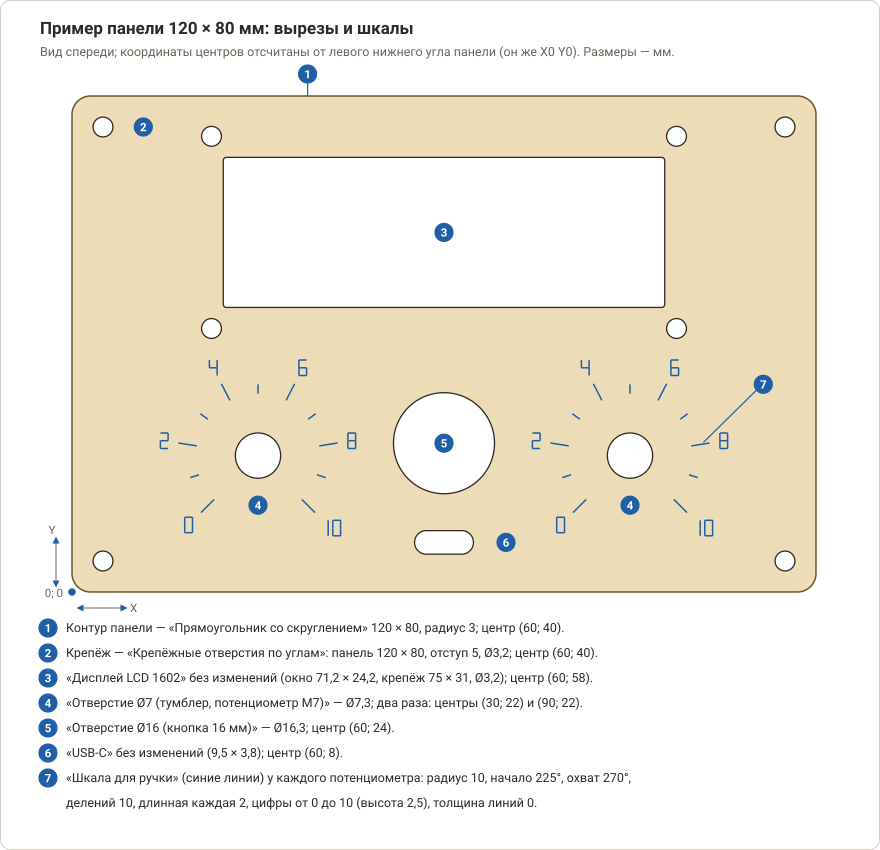

# Изготовление приборной панели

Как сделать лицевую панель для самоделки — прибора, пульта, блока питания — из фанеры, акрила или тонкого алюминия на
фрезерном станке (CNC 3018) или лазером: окна под дисплей, отверстия под ручки, кнопки и разъёмы, шкалы вокруг
потенциометров, фаски и потайные отверстия под винты. Библиотека вырезов и шкал описана в
[справочнике](boxes-panels.md#4-вырезы-для-панели) — здесь порядок работы от измерения деталей до готовой панели и всё,
от чего зависит, сядут ли детали в отверстия с первого раза. Корпус под панель — в
[руководстве по коробкам](box-making.md).

*Пример панели 120 × 80 мм из этого руководства: дисплей LCD 1602, два потенциометра со шкалами, кнопка и разъём USB-C.*

[← Назад к README](../README.md) · [Справочник: коробки и панели](boxes-panels.md) · [Коробка](box-making.md) · [Все операции](operations/README.md)

---

## Коротко

1. Измерьте штангенциркулем детали, которые встанут в панель (ручки, разъёмы, дисплей), и толщину листа.
2. «Станок»: профиль, «Толщина заготовки», ноль X/Y — левый нижний угол. «Инструменты»: фреза Ø3,175 и V-фреза 90°
   (для шкал и фасок) — или лазер.
3. «Конструктор»: контур панели, крепёжные отверстия, вырезы под детали, шкалы вокруг ручек — всё **внутри** контура
   панели.
4. Операции в таком порядке: шкалы → фаски → отверстия → окна → контур панели. Так инструмент меняется один раз.
5. Вырежьте **пробные отверстия** и примерьте детали, прежде чем резать чистовую панель.
6. Закрепите лист по всей площади, выставьте ноль, пройдите программу по воздуху — и режьте.

## Содержание

1. [Что понадобится](#1-что-понадобится)
2. [Материал и размеры панели](#2-материал-и-размеры-панели)
3. [Станок, заготовка и инструмент](#3-станок-заготовка-и-инструмент)
4. [Контур панели и вырезы](#4-контур-панели-и-вырезы)
5. [Шкалы вокруг ручек](#5-шкалы-вокруг-ручек)
6. [Операции и их порядок](#6-операции-и-их-порядок)
7. [Пробные отверстия и посадка деталей](#7-пробные-отверстия-и-посадка-деталей)
8. [Фрезерный станок: закрепление и резка](#8-фрезерный-станок-закрепление-и-резка)
9. [Лазер](#9-лазер)
10. [Панель и коробка](#10-панель-и-коробка)
11. [Отделка и сборка](#11-отделка-и-сборка)
12. [Если что-то не так](#12-если-что-то-не-так)

---

## 1. Что понадобится

- **Лист** толщиной 2–4 мм: фанера (берёзовая режется чище хвойной), МДФ, литой акрил, алюминий. Прозрачный акрил
  диодный лазер не берёт — нужен фрезер или тёмный акрил. Алюминий для 3018 — на пределе возможностей, подробности в
  [разделе 8](#8-фрезерный-станок-закрепление-и-резка).
- **Инструмент** (вкладка «Инструменты»):
  - концевая фреза Ø3,175 — в новом проекте она уже есть как **T1**;
  - V-фреза 90° Ø3,175 — пресет «V-карвинг: V-фреза 90° Ø3,175»: для шкал, подписей и фасок. Для тонких линий шкал
    можно взять гравёр 60° («Гравировка: Гравёр 60°, кончик 0,2»);
  - для отверстий меньше фрезы — сверло (в новом проекте есть «Сверло Ø3») или фреза Ø2 («Фреза 1-заходная Ø2»);
  - или лазерный модуль — пресет «Лазер: Лазерный модуль 5 Вт» либо «10 Вт».
- **Штангенциркуль и сами детали** — потенциометры, кнопки, разъёмы, дисплей. Размеры из каталога годятся только как
  первое приближение: измеряйте то, что у вас в руках.
- **Двусторонний и малярный скотч**, жертвенный лист под заготовку, наждачная бумага P240–P400, надфили, краска или
  тушь для заливки гравировки.
- **Безопасность:** очки, при фрезеровании МДФ — пылесос и респиратор; лазер — вытяжка наружу, от станка не
  отходить. Подробно — в [первом запуске 3018](first-run-3018.md) и [с лазером](first-run-3018-laser.md).

## 2. Материал и размеры панели

**Толщина.** Резьбовая часть втулки потенциометра, тумблера или гнезда обычно 5–8 мм, и на ней должны уместиться
панель, шайба и гайка. Поэтому лист для панели берут **2–3 мм**; 6 мм фанеры для таких деталей уже много — проверьте
длину резьбы своих деталей. Толщину листа измерьте штангенциркулем в 3–4 местах и впишите среднее в «Толщину
заготовки» ([раздел 3](#3-станок-заготовка-и-инструмент)).

**Расстановка.** Нарисуйте панель на бумаге в натуральную величину и приложите к ней детали:

- от кромки панели до края выреза — **не меньше 5 мм**; у крепёжного отверстия Ø3,2 с отступом 5 мм от кромки до
  стенки отверстия остаётся 3,4 мм;
- между краями соседних вырезов — **не меньше толщины листа**, лучше 3–4 мм: узкая перемычка (особенно в фанере
  вдоль волокон) ломается;
- ручки считайте по **диаметру ручки**, а не отверстия: между ручками должно оставаться 3–5 мм, а вокруг ручки со шкалой
  — место под шкалу ([раздел 5](#5-шкалы-вокруг-ручек));
- под дисплеем и платой оставьте место под стойки и разъёмы за панелью;
- всё нарисованное должно лежать внутри контура панели — иначе вырастет габарит чертежа и уедет ноль X/Y
  ([раздел 3](#3-станок-заготовка-и-инструмент)).

**Размер панели** определяется расстановкой или коробкой ([раздел 10](#10-панель-и-коробка)). Поле станка у профилей 3018
— 300 × 180 мм: панель больше не поместится целиком.

## 3. Станок, заготовка и инструмент

1. Вкладка **«Станок»** → профиль → **«Применить»**: для фрезера **«CNC 3018 Pro (шпиндель 775)»** (в новом проекте он
   уже выбран), для лазера — **«CNC 3018 Pro (лазер 5 Вт)»** или **«(лазер 10 Вт)»**.
2. В группе **«Заготовка и ноль»**:
   - **«Толщина заготовки, мм»** — измеренная толщина листа. В новом проекте там 10 мм — исправьте **до** того, как
     добавлять операции: «Отверстия по спирали» берут из этого поля глубину при создании;
   - **«Ноль X/Y»** — «Левый нижний угол», **«Ноль Z»** — «Верх заготовки».
3. **«Инструменты»:** T1 уже есть; остальные — кнопкой «Добавить» из пресетов. Инструмент PathForge выбирает сам только
   для «+ Фаска» (V-фреза с самым большим углом при вершине), «+ Отверстия по спирали» (самая крупная концевая фреза)
   и «+ Сверление» (первое сверло). Для остальных операций инструмент задаётся в поле **«Инструмент»** операции — не
   забудьте выбрать V-фрезу у шкал.
4. **Ноль X/Y берётся от габарита всего чертежа.** Если всё нарисовано внутри контура панели, это левый нижний угол
   панели. Выступившая за контур шкала или надпись сдвинет ноль — проверьте на 2D-виде и в сводке операций.

## 4. Контур панели и вырезы

Все вырезы — на вкладке **«Конструктор»** → **«Вырезы для панели»**. Каждый вырез создаётся на слое «Вырезы» отдельными
контурами и сразу выделяется. Координаты центров удобно отсчитывать от левого нижнего угла панели — тогда они совпадают
с эскизом на бумаге.

1. **Новый проект** (Ctrl+N), профиль и толщина — по [разделу 3](#3-станок-заготовка-и-инструмент). Готовый контур
   панели из DXF или SVG тоже подойдёт: **Ctrl+I** заменит текущий чертёж, поэтому импортируйте его до вырезов.
2. **Контур панели:** вырез «Прямоугольник со скруглением» → «Ширина, мм» и «Высота, мм» — размеры панели, «Радиус, мм» —
   2–4 (скруглённые углы приятнее и не сколются), «Центр X / Y» — **половина ширины и высоты** (у панели 120 × 80 мм —
   60 и 40), «поворот °» — 0 → **«+ Вырез»**.
3. **Крепёж по углам:** вырез «Крепёжные отверстия по углам» → ширина и высота панели, «Отступ от края» (5 мм), «Диаметр»
   (3,2 — под винт M3). Центр — центр панели: кликните по контуру панели (он выделится) и нажмите **«По выделению»** — или
   впишите те же 60 и 40. «+ Вырез».
4. **Остальное** — вырез по одному: выберите в списке, поправьте размеры под **измеренную деталь**, введите «Центр X / Y»
   и «поворот °» (против часовой стрелки) → «+ Вырез». Центр можно взять и с чертежа: кликните по нарисованной метке
   или контуру и нажмите «По выделению».

Пример панели с рисунка:

| № | Вырез в списке | Что поменять | Центр X; Y |
|---|---|---|---|
| 1 | Прямоугольник со скруглением | Ширина 120, Высота 80, Радиус 3 | 60; 40 |
| 2 | Крепёжные отверстия по углам | Ширина панели 120, Высота панели 80, Отступ 5, Диаметр 3,2 | 60; 40 |
| 3 | Дисплей LCD 1602 | без изменений (окно 71,2 × 24,2, крепёж 75 × 31, Ø3,2) | 60; 58 |
| 4 | Отверстие Ø7 (тумблер, потенциометр M7) | без изменений (Ø7,3) — два раза | 30; 22 и 90; 22 |
| 5 | Отверстие Ø16 (кнопка 16 мм) | без изменений (Ø16,3) | 60; 24 |
| 6 | USB-C | без изменений (9,5 × 3,8) | 60; 8 |

**Повторяющиеся вырезы** — раздел **«Изменить выделенное»** на той же вкладке. Копии сразу попадают во все операции, где
был исходный контур.

- **«Массив»** — сетка: выделите отверстие, задайте «Массив: столбцы × ряды» (штуки вместе с исходным) и «Шаг X / Y»,
  нажмите «Массив». Ряд из четырёх кнопок через 25 мм: столбцы 4, ряды 1, шаг 25 и 0.
- **«По кругу»** — отверстия по окружности (крепёж фланца, вентиляция): кликните по центральному отверстию и нажмите
  «По выделению» — центр встанет в его центр; затем выделите копируемое отверстие, задайте «По кругу: штук, угол °»
  (штуки вместе с исходным, 360 — равномерно по всему кругу) и нажмите «По кругу». Шесть отверстий вокруг центра: 6 и
  360. Галочка «Поворачивать копии» у круглых отверстий роли не играет, у вытянутых окон поворачивает их вместе с кругом.

**На что смотреть у разных деталей**

- **Потенциометры, тумблеры, кнопки** (вырезы «Отверстие Ø7» … «Отверстие Ø22»). Библиотека уже прибавляет к номиналу
  0,3 мм. Измерьте диаметр резьбы **вашей** детали и впишите «Диаметр» = диаметр + 0,2…0,4 мм. У деталей с лыской
  (тумблеры, многие кнопки) задайте «Лыска (по лыске)» — расстояние между лыской и противоположной стороной отверстия;
  лыска смотрит вверх, а повернуть её можно в поле «поворот °».
- **Разъёмы** (USB, D-Sub, XLR, гнёзда питания). Окно делайте по самому разъёму, а не по его фланцу, плюс 0,2–0,3 мм
  на посадку. У гнёзд питания и аудиоразъёмов диаметр резьбы у разных производителей разный — измерьте.
- **Дисплеи** (LCD 1602 / 2004, OLED). В библиотеке типовое окно и четыре крепёжных отверстия. Сверьте окно с видимой
  частью и рамкой модуля, а крепёж — с платой: у клонов он иногда смещён на миллиметр. Модуль лучше ставить на стойках
  M3 высотой 5–6 мм.
- **Вентиляция** (отверстия, щели, соты). Размер области — это размеры *рамки*: в неё помещаются только **целые**
  отверстия, поэтому узор бывает чуть меньше заданного. Фрезой делайте щели и отверстия крупнее фрезы с перемычками от
  2 мм; тонкие соты — задача для лазера.

## 5. Шкалы вокруг ручек

**«Конструктор» → «Шкала для ручки»**: кликните по отверстию под вал потенциометра или переключателя и нажмите
**«По выделению»** — центр шкалы встанет в центр отверстия. Заполните поля → **«+ Шкала»**. Риски и цифры появятся на
слое «Шкала» и будут выделены.

| Поле | Что значит | Пример (потенциометр 0…10) |
|---|---|---|
| **Радиус рисок, мм** | Откуда начинаются риски: чуть больше радиуса ручки | 10 (для ручки Ø16; для Ø20 — 12) |
| **Начало °, охват °** | Угол первой риски от оси X против часовой стрелки; сколько градусов шкала занимает **по часовой** | 225 и 270 |
| **Делений, длинная каждая** | Число промежутков между рисками (рисок на одну больше); каждая N-я риска длинная и с цифрой | 10 и 2 |
| **Длина рисок, мм** | Короткая и длинная | 1,5 и 3 |
| **Цифры от, до** | Число у первой и у последней риски; остальные — равномерно между ними | 0 и 10 |
| **Высота цифр, толщина линий** | Высота цифр, мм (0 — без цифр); толщина линий (0 — линии) | 2,5 и 0 |
| **Дуга по началу рисок** | Дуга вдоль начала рисок | выкл. |

Шкала симметрична относительно «12 часов», если **начало = 90 + охват / 2**: для 270° это 225°, для 300° — 240°.
Примеры:

| Ручка | Радиус | Начало | Охват | Делений | Длинная каждая | Цифры |
|---|---|---|---|---|---|---|
| Потенциометр, 0…10 | 10 | 225 | 270 | 10 | 2 | 0…10 |
| Потенциометр, только риски | 10 | 225 | 270 | 20 | 5 | высота 0 |
| Переключатель на 6 положений, шаг 30° | 10 | 165 | 150 | 5 | 1 | 1…6 |
| Переключатель на 3 положения, шаг 45° | 10 | 135 | 90 | 2 | 1 | 1…3 |

**Место под шкалу.** Шкала 225° / 270° с цифрами 2,5 мм выступает от центра на «радиус рисок + 6 мм» вбок и вверх и на
«радиус рисок + 3 мм» вниз (внизу шкала разомкнута). Для радиуса 10 это 16 мм вбок: центры двух таких ручек разнесите
не меньше чем на 35 мм, а от центра ручки до кромки панели оставьте не меньше 16 мм (вниз — 13 мм): иначе шкала выйдет
за контур. С цифрами 3 мм прибавьте около полмиллиметра.

- **Линии (толщина 0)** — гравируйте операцией «Контур» «По линии» V-фрезой или гравёром либо лазером. Цифры рисуются
  семисегментным шрифтом прямыми штрихами. При ширине линии 0,4–0,5 мм цифры читаются от 3 мм высотой.
- **Толщина больше 0** (0,5–0,8) — замкнутые контуры такой ширины: для «+ V-карвинг» (штрихи ровной ширины, острые углы)
  или заливки лазером.
- Шкала не знает про ручку. Насаживайте ручку так, чтобы её указатель смотрел на первую риску, когда вал повёрнут **до
  упора против часовой стрелки** — иначе шкала будет врать.
- **Подписи** («ГРОМКОСТЬ», «ВКЛ») — вкладка «Текст» ([инструкция](operations/text.md)): шрифт без тонких штрихов, высота
  букв 4–5 мм; гравируйте «+ V-карвинг» ([инструкция](operations/vcarve.md)) V-фрезой с глубиной-пределом 0,5 мм или
  лазером «Заливка».

## 6. Операции и их порядок

Операции выполняются **сверху вниз**, порядок меняют кнопки ▲ и ▼. Правила простые:

- сначала то, что делает V-фреза: шкалы и подписи на ровном целом листе, потом фаски; затем концевая фреза: отверстия,
  окна и **контур панели — последним**. При смене инструмента программа делает паузу, и Z0 выставляют заново, поэтому
  чем меньше смен, тем лучше;
- контур панели — последним, потому что до этого лист держится целиком и ничего не сдвинется.

Назовите операции в поле «Название» («Шкалы», «Фаски», «Отверстия», «Окна», «Панель») — по ним легко ориентироваться.
Контуры выделяйте перед нажатием «+ …»: **«Слои» → «Выделить»** (все контуры слоя «Шкала»); меню **«Выделение» →
«Выделить окружности»** (все круглые отверстия); одно отверстие + **«Выделить отверстия того же диаметра»**; клик по
контуру и **Ctrl**+клик — несколько; **Shift** + протянуть вправо — рамка. Позже набор меняет **«Назначить выделенные»**.

Для примера панели:

| № | Операция | Контуры | Инструмент | Что поставить |
|---|---|---|---|---|
| 1 | «Шкалы»: **+ Контур** | слой «Шкала» | V-фреза 90° (или гравёр 60°) | «Сторона» — «По линии»; «Глубина» — 0,2; «Способ» врезания — «Вертикально» |
| 2 | «Фаска кромки»: **+ Фаска** | контур панели | V-фреза выбирается сама | «Где» — «Снаружи (кромка детали)»; «Ширина фаски» — 0,8–1 |
| 3 | «Потай»: **+ Фаска** | крепёжные отверстия Ø3,2 | V-фреза | «Где» — «Внутри (отверстие, потай)»; ширина = (Ø головки − Ø отверстия) / 2 |
| 4 | «Отверстия»: **+ Отверстия по спирали** | все окружности | T1 Ø3,175 | глубина — толщина + 0,2 (подставляется сама) |
| 5 | «Окна»: **+ Контур** | окно дисплея, USB-C | T1 | «Сторона» — «Внутри»; «Глубина» — толщина + 0,2; «Подрезка углов» — **Dogbone** |
| 6 | «Панель»: **+ Контур** | контур панели | T1 | «Сторона» — «Снаружи»; «Глубина» — толщина + 0,2 |

- **Как выделить.** Контур панели — кликом по его кромке. Окна — клик по одному и **Ctrl**+клик по остальным. Для потая —
  клик по крепёжному отверстию и «Выделение» → «Выделить отверстия того же диаметра»: в примере выделятся и четыре
  отверстия дисплея (они тоже Ø3,2) — потай на них не помешает; лишнее снимите **Ctrl**+кликом.
- **«+ Контур»** ставит глубину 3 мм: впишите толщину листа **плюс 0,2 мм** (чтобы резать насквозь). Если глубина
  больше толщины заготовки более чем на 0,5 мм, PathForge предупредит: «… фреза уйдёт в стол».
- **Фаска.** Глубина считается сама: ширина / tg(половины угла V-фрезы); у 90° она равна ширине. Ширина фаски не больше
  (Ø фрезы − кончик) / 2: у V-фрезы Ø3,175 это 1,56 мм, у «V-фреза 90° Ø6 (фаски, цанга 6 мм)» — 2,95 мм; иначе PathForge
  предупредит, что фаска шире конуса. Для листа 3 мм берите фаску до 1 мм.
  **Потай** под винт с потайной головкой: головка Ø6 мм на отверстие Ø3,2 даёт ширину (6 − 3,2) / 2 = 1,4 мм.
- **Окна и «Подрезка углов».** Круглая фреза оставляет в углу окна скругление своего радиуса (1,6 мм). Dogbone добавляет
  в углу «ушко», чтобы в окно вошёл квадратный дисплей или разъём; у скруглённых углов радиусом больше фрезы (USB-C)
  подрезки нет, поэтому одна операция «Окна» с Dogbone подходит и для USB-C, и для дисплея. Рамка дисплея обычно
  закрывает ушки; если нет — оставьте у окна «Подрезку углов» «Нет» и подпилите углы надфилем либо вырежьте окно
  лазером.
- **Круглые отверстия.** В «Отверстиях по спирали» только окружности; всё остальное PathForge пропустит с
  предупреждением. Отверстие, равное фрезе по диаметру (Ø3,2 при Ø3,175), фреза проходит как сверло — просто опускается.
  Отверстие меньше фрезы пропускается: берите сверло («+ Сверление», [инструкция](operations/drilling.md)) или фрезу Ø2.
- **Потай после отверстий** получается чуть чище (V-фреза идёт по пустому отверстию), но тогда инструмент меняется три
  раза: V-фреза → фреза (отверстия) → V-фреза (потай) → фреза (окна и контур). Для листа 3 мм достаточно порядка из
  таблицы.
- Проверьте программу: вкладка «Сообщения» — без предупреждений «⚠»; **«3D-симуляция»**
  ([инструкция](operations/simulation.md)) — отверстия и окна сквозные, фаски ровные, шкалы разборчивые.

## 7. Пробные отверстия и посадка деталей

Фрезой отверстие выходит в размер с точностью порядка ±0,05–0,1 мм (зависит от биения шпинделя, износа фрезы и
материала), лазер выжигает полоску 0,1–0,3 мм, а фанера разбухает от влаги. Поэтому для нового материала и для дорогого
листа (акрил, алюминий) сначала вырежьте **пробную пластинку** с отверстиями разного диаметра.

1. **Файл → Новый проект** (Ctrl+N): профиль и «Толщина заготовки» — те же, что для панели.
2. «Конструктор» → «Вырезы для панели» → «Круглое отверстие»: пять отверстий вокруг номинала вашей детали (для примера —
   7,0), «+ Вырез» для каждого:

   | Диаметр | 7,0 | 7,1 | 7,2 | 7,3 | 7,4 |
   |---|---|---|---|---|---|
   | Центр X; Y | 10; 10 | 22; 10 | 34; 10 | 46; 10 | 58; 10 |

3. Контур пластинки: «Прямоугольник со скруглением» 68 × 20, радиус 2, центр 34; 10 → «+ Вырез».
4. Операции — как для панели ([раздел 6](#6-операции-и-их-порядок)): «+ Отверстия по спирали» на все окружности
   («Выделение» → «Выделить окружности») и «+ Контур» «Снаружи» на пластинку; глубина — толщина + 0,2 мм. Инструмент и
   режим — те же, что пойдут в дело.
5. Вырежьте и вставьте в отверстия **настоящую деталь**. Подходит самое маленькое отверстие, в которое деталь входит от
   лёгкого нажима пальцем и не болтается. Его диаметр и есть «Диаметр» вашего выреза на панели.

Для другой детали — такая же пластинка вокруг её размера. Результат:

| Как сидит | Что менять |
|---|---|
| Входит от лёгкого нажима | Хорошо — берите этот диаметр |
| Не входит или входит молотком | «Диаметр» больше на 0,1–0,2; лазер — проверьте ширину реза и режим компенсации («Детали в размер» / «Отверстия в размер», [раздел 9](#9-лазер)) |
| Болтается | «Диаметр» меньше на 0,1; лазер — ширина реза введена больше настоящей |
| Одно отверстие туже других | Фанера неровная по толщине или фрезу «ведёт» — это нормально, если разница в пределах 0,1 мм |

Пробную пластинку лучше сделать **до** операций панели: вырез уже готового проекта размер не меняет. Если размер всё же
пришлось поправить, выделите контур, нажмите **Del** и создайте вырез заново — новый контур нужно снова назначить
операции («Назначить выделенные»).

## 8. Фрезерный станок: закрепление и резка

**Закрепление.** Шкала глубиной 0,2 мм повторяет все неровности листа: если он лежит волной, где-то риски выйдут
глубже, а где-то пропадут. Поэтому:

- Жертвенный лист должен быть ровным. Если стол «горбатый», выровняйте его операцией «Торцовка»
  ([инструкция](operations/facing.md)).
- Лист — на двусторонний скотч **по всей нижней стороне**; струбцины и саморезы — за пределами панели, не ближе 10 мм к
  вырезам. Вырезанные окна и пробки отверстий остаются приклеенными к скотчу — это нормально, перемычек не нужно.
- Без скотча нужны перемычки на наружном контуре (в «Контуре» группа «Перемычки»: «Количество» 4, «Ширина» 4,
  «Высота» 1 мм): потом их срезают ножом и зачищают.

**Ноль и смена инструмента.** X0 Y0 — левый нижний угол панели, Z0 — на верх листа. Для шкалы глубиной 0,2 мм Z0 нужно
выставлять **щупом** («Найти Z щупом»), а не на глаз. Ноль X/Y ставьте в 8–10 мм от кромки листа внутрь: фреза идёт по
контуру снаружи, на радиус дальше. После V-фрезы программа остановится на `M0`: смените инструмент на фрезу Ø3,175,
**выставьте только Z0** (ноль X/Y не трогайте) и нажмите «Продолжить» —
[подробно](pcb-milling.md#75-смена-инструмента). Проход «по воздуху» — в [первом запуске](first-run-3018.md), шаги 8–10.

**Режимы.** Пресеты — осторожные стартовые значения для 3018:

| Материал / инструмент | Подача, мм/мин | Врезание, мм/мин | Шаг по глубине, мм |
|---|---|---|---|
| Дерево, фанера — «Фреза 1-заходная Ø3,175» | 400 | 120 | 1,0 |
| МДФ — «Фреза 1-заходная Ø3,175» | 450 | 120 | 1,2 |
| Акрил — «Фреза 1-заходная Ø3,175 (O-flute)» | 350 | 80 | 0,8 |
| Алюминий — «Фреза 1-заходная Ø3,175» | 150 | 40 | 0,2 |
| V-фреза 90° Ø3,175 | 400 | 100 | 1,0 |
| Гравёр 60°, кончик 0,2 | 250 | 60 | 0,1 |

- Лист 3 мм режется насквозь на глубину 3,2 мм — четыре прохода. Подачу при необходимости убавляйте кнопкой **«−10 %»**
  в строке «Подача» на «Пульте».
- Лицевая сторона панели — верхняя, а обычная фреза со стружкой вверх рвёт именно верх. Если для фанеры или МДФ это
  важно, возьмите пресет «Дерево, фанера: Фреза Ø3,175 стружка вниз (чистый верх фанеры)» или компрессионный — «Дерево,
  фанера: Фреза компрессионная Ø3,175 (без сколов с двух сторон)».
- Акрил: оставьте защитную плёнку на лицевой стороне, подачу не поднимайте — стружка должна уходить, а не плавиться.
- **Алюминий 1–2 мм.** Подача 150 мм/мин, шаг 0,2 мм: на лист 2 мм — десять проходов. Смазывайте зону реза каплями
  спирта или WD-40, стружку убирайте пылесосом, лист крепите по периметру жёстко (одного скотча мало). Сначала
  отработайте программу на дереве.
- Слушайте станок: визг, дым, чёрный край — меньше подача; сильный удар — **■ Стоп**.

**Перед стартом:** «Толщина заготовки» и глубины операций совпадают с листом; ноль выставлен; в «3D-симуляции» всё как
задумано; лист закреплён; очки надеты, пылесос включён; проход по воздуху сделан.

## 9. Лазер

1. «Станок» → профиль **«CNC 3018 Pro (лазер 5 Вт)»** или **«(лазер 10 Вт)»** → «Применить»; «Инструменты» → пресет
   «Лазер: Лазерный модуль 5 Вт» (или «10 Вт»). **Фокус** — на поверхности. Режимы подбирают
   [тест-сеткой](operations/laser-test-card.md), все поля операции описаны
   [в инструкции по лазеру](operations/laser-vector.md).
2. На панель нужны **две операции «+ Лазер»**:

   | Операция | Контуры | Что поставить |
   |---|---|---|
   | «Шкалы» (первая) | слой «Шкала» («Слои» → «Выделить») | «Режим» — «По линии», режим гравировки из тест-сетки; **обдув выключен** (в режиме «По линии» он включается сам — снимите галочку) |
   | «Панель» | контур панели **и** все отверстия и окна | «Режим» — «По линии», режим резки, **обдув включён**, «Микроперемычки» 2–4, компенсация ширины реза — «Детали в размер» |

3. **Ширина реза.** В новой операции компенсация выключена («Нет — точно по линии»), а ширина стоит 0,15 мм. Вырежьте
   квадрат 20 мм тем же режимом и измерьте: ширина реза = 20 − измеренный размер. Впишите её в «Ширина реза, мм» и
   выберите режим компенсации.
4. **Какой режим компенсации.** PathForge считает вложенность контуров внутри одной операции: контур внутри другого —
   отверстие. Если отверстия и окна режутся в одной операции с контуром панели, ставьте «Детали в размер»: контур панели
   сдвинется наружу, а отверстия внутрь на половину ширины реза — и панель, и отверстия выйдут в размер. Отверстия
   режутся первыми, контур панели — последним; микроперемычки делаются только на нём. Если отверстия вынесены в
   **отдельную** операцию без контура панели, выбирайте «Отверстия в размер»: иначе они станут больше на ширину реза.
5. **Подрезка углов** лазеру не нужна — окна выходят с прямыми углами. Перемычки между вырезами оставляйте от 2 мм.
6. **Шкалы.** Режим подберите на обрезке тест-сеткой: линию нужно получить тёмной, но не прожигающей лист. Пятно лазера
   тонкое (у пресетов 0,1–0,15 мм), поэтому цифры высотой 2,5–3 мм читаются. Для более жирных штрихов задайте в шкале
   «Толщину линий» 0,5–0,8 и гравируйте их в режиме «Заливка штриховкой». «Шкалы» ставьте первой операцией, пока лист
   цел.
7. **Перед стартом:** «Пульт» → **«⬚ Обвести рамку»** (лазер на 1 % проходит по границе задания — проверьте, что оно на
   материале), затем «▶ Старт». Не отходите от станка.
8. Кромка после лазера тёмная: зачистите наждачкой или закрасьте торец. С панели протрите копоть сухой тряпкой или
   салфеткой со спиртом.

## 10. Панель и коробка

Размер и крепление панели зависят от того, как она сядет на корпус:

| Вариант | Размер панели | Крепление |
|---|---|---|
| **Накладная панель на коробке «Без крышки»** | наружный размер коробки: для 100 × 60 мм внутри и листа 3 мм — **106 × 66 мм** | на винтах M3 в угловые стойки (бруски 6 × 6 мм вровень с верхом стенок, приклеенные в углы коробки). «Отступ от края» крепёжных отверстий = толщина стенки + 3 мм, для 3 мм — 6 мм |
| **Сдвижная крышка как панель** | размер крышки из «+ Коробка»: для той же коробки — **102,8 × 64,4 мм** | едет в пазах; вырезы и шкалы держите **не ближе 4 мм** к краям крышки |
| **Стенка коробки как панель** | размер стенки; детали на чертеже нарисованы изнутри | вырезы и их зеркальность — в [руководстве по коробкам](box-making.md#10-отверстия-и-вырезы-в-стенках) |

- Для накладной панели в «Прямоугольнике со скруглением» поставьте размер из таблицы и радиус 0–2 мм. Рисунок панели на
  чертеже — **вид спереди**: при резке лицевая сторона лежит сверху, зеркалить ничего не нужно.
- Крышку с вкладышем («Накладная» в «+ Коробка») для панели не используйте: вкладыш закроет окна. Берите коробку «Без
  крышки», а панель делайте отдельной деталью.
- Коробку и панель делайте в **двух проектах** (Ctrl+N для второго): в одном проекте коробка встанет справа от панели,
  ноль X/Y возьмётся от габарита всего чертежа, и вместе они обычно не помещаются в поле станка (300 × 180 мм).

## 11. Отделка и сборка

1. **Зачистка.** Сошлифуйте ворс и заусенцы (P240–P400); у алюминия снимите заусенцы надфилем. Ушки подрезки углов в
   видимых местах подпилите по рамке.
2. **Контраст гравировки.** Шкала и подписи читаются плохо, пока они одного цвета с листом. Три способа:

   | Способ | Как | Для чего |
   |---|---|---|
   | Тёмный лист заранее | Возьмите окрашенный, анодированный или заклеенный плёнкой лист (или закрасьте лицевую сторону и дайте высохнуть) и гравируйте: линии выйдут светлыми по тёмному | фанера и МДФ после покраски, анодированный алюминий |
   | Залить после | Протрите канавки краской, тушью или маркером, дайте подсохнуть и сошлифуйте поверхность (P240–P400): краска останется только в линиях | дерево, акрил |
   | Двухслойный гравировальный пластик | Верхний слой 0,3–0,5 мм гравируется на всю толщину — виден нижний цвет; глубина гравировки равна толщине верхнего слоя | пластиковые панели |

3. **Защита.** Матовый лак или масло по готовой панели; акрил — только чистка.
4. **Установка деталей.** Потенциометры, тумблеры и гнёзда — на гайку с шайбой; затягивайте без перекоса и не
   перетягивайте: фанера и акрил под гайкой мнутся и трескаются. Кнопки и индикаторы — по резьбе. Дисплей — на стойки
   M3, между рамкой и панелью — тонкая прокладка.
5. **Ручки.** Поверните вал потенциометра до упора против часовой стрелки, насадите ручку указателем на **первую риску**
   шкалы и затяните винт.
6. **Панель на корпус** — по [разделу 10](#10-панель-и-коробка). Сначала примерьте всухую.

## 12. Если что-то не так

| Признак | Что делать |
|---|---|
| Деталь не входит в отверстие | «Диаметр» больше на 0,1–0,2 ([раздел 7](#7-пробные-отверстия-и-посадка-деталей)); лазер: ширина реза меньше настоящей — измерьте её |
| Деталь болтается | «Диаметр» меньше на 0,1; лазер: ширина реза введена больше настоящей; фанера — не разбухла ли |
| Отверстия лазера больше нужного | Отверстия резались отдельной операцией с режимом «Детали в размер» — поставьте «Отверстия в размер» ([раздел 9](#9-лазер)) |
| «… контур №… не окружность — пропущен» | В «Отверстиях по спирали» только окружности: окна и прорези — «Контур» «Внутри» |
| «… отверстие №… (Ø…) меньше фрезы Ø… — пропущено» | Отверстие меньше фрезы: сверло («+ Сверление») или фреза Ø2 / Ø1,5 |
| «… фаска … мм шире конуса фрезы …» | Ширина больше (Ø − кончик) / 2: возьмите V-фрезу Ø6 или сделайте фаску уже |
| «… для фаски выберите V-фрезу (гравёр)» | В операции стоит концевая фреза: в поле «Инструмент» — V-фреза |
| В углах окна «ушки» | Это подрезка углов. Если ушки видны — «Подрезка углов» «Нет» (углы скруглятся радиусом фрезы, 1,6 мм) и подпилите углы надфилем; лазер ушек не делает |
| Глубина шкалы разная в разных местах | Лист не плоский или Z0 выставлен на глаз: скотч по всей площади, Z0 щупом, жертвенный лист выровнять |
| Цифры зеркальные | Лист лежит лицом вниз: рисунок — вид спереди, лицо должно быть сверху |
| Шкала не по центру ручки | «По выделению» брали с другого контура; кликните по отверстию под вал и повторите |
| Ноль X/Y оказался не в углу панели | Что-то нарисовано за контуром панели (чаще всего шкала у края): сдвиньте ручку от края или уменьшите «Радиус рисок» |
| Цифры мелкие и слабые | «Высота цифр» 3 мм и больше; глубина 0,25 мм; более острая V-фреза или гравёр |
| Сколы по верхней кромке | Попутное фрезерование, острая фреза; верх фанеры — «стружка вниз», по линии реза — малярный скотч |
| Панель сорвало при резке | Скотч по всей нижней стороне; в крайнем случае — 4 перемычки |
| «Программа занимает по Y … мм, а ход станка …» | Панель больше поля станка 300 × 180 мм: делайте панель меньше или режьте частями |
| Отверстия смещены друг относительно друга | Ноль X/Y сдвинули при смене инструмента: меняйте только Z0 |

Дальше — [коробка](box-making.md) для этой панели и [справочник](boxes-panels.md) по всем полям генераторов.
