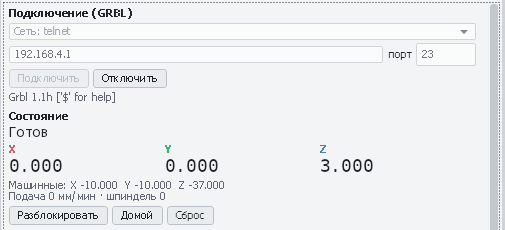
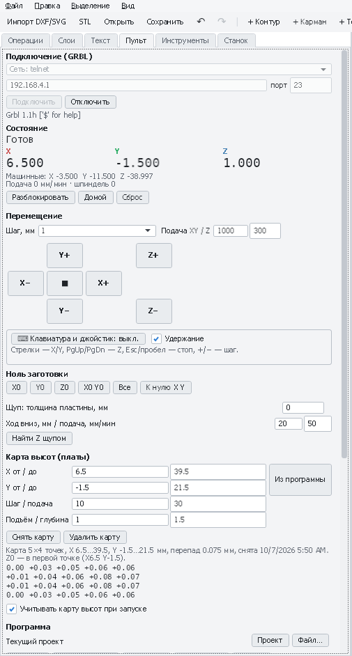

# Плата MKS DLC32: подключение и настройка станка

MKS DLC32 — плата на ESP32 с прошивкой [MKS-DLC32-FIRMWARE](https://github.com/makerbase-mks/MKS-DLC32-FIRMWARE),
сделанной на основе **Grbl_Esp32**. Для PathForge она выглядит как обычный GRBL 1.1 (отвечает `Grbl 1.1 ['$' for help]`),
но в ней есть отличия от Arduino-плат (Woodpecker и похожих): WiFi, сенсорный экран, SD-карта, свои настройки
и поведение. Здесь собрано то, что нужно знать, чтобы настроить на ней станок и работать из PathForge.

Значения по умолчанию в этом документе взяты из исходников прошивки (машина `i2s_out_xyz_mks_dlc32.h`, версия
V2.1). Прошивка в вашей плате может быть другой: **всегда сверяйтесь с ответом платы на `$$`**.

[← Назад к README](../README.md)

---

## 1. Что на плате

| Что | Как устроено на DLC32 | Что это значит на практике |
|---|---|---|
| Процессор | ESP32, шаговые сигналы идут через сдвиговый регистр (I2S) | Всё управление — в прошивке, отдельного Arduino нет |
| USB | Чип CH340, скорость **115200** | Нужен драйвер CH340, как у большинства плат 3018 |
| Оси | 3 оси X, Y, Z (есть отдельная прошивка для CoreXY) | Для 3018 — обычная XYZ-прошивка |
| Драйверы моторов | Съёмные модули | Микрошаг задаётся перемычками под драйвером — от него зависят `$100`–`$102` |
| Концевики | X — GPIO36, Y — GPIO35, Z — GPIO34 | Логика входов по умолчанию инвертирована (`$5=1`); подключайте по схеме своей версии платы |
| Щуп | GPIO22 (плата V2.x) | Логика входа по умолчанию инвертирована (`$6=1`) |
| Шпиндель / лазер | ШИМ-выход GPIO32 (плата V2.x) | Плата задумана в первую очередь для лазера; мотор 775 подключайте через внешний драйвер (модуль MOSFET с ШИМ-входом или регулятор шпинделя) — проверьте по схеме своей версии платы |
| Охлаждение (M8) | Выведено на GPIO4 (общий с I2C) | Обычно не используется |
| Экран и SD-карта | Разъём сенсорного экрана MKS, слот microSD | Можно запускать файлы прямо с карты — см. раздел 7 |

## 2. Подключение к PathForge

Вкладка **«Пульт»** → список способа подключения под заголовком «Подключение (GRBL)»:

| Вариант | Когда выбирать | Адрес и порт |
|---|---|---|
| **USB: MKS DLC32 (ESP32)** | Самый надёжный способ, особенно для долгих работ. **Выбирайте его для DLC32**: линии DTR/RTS остаются опущенными, плата не уходит в загрузчик ESP32, а попавшую в него PathForge перезапускает (см. ниже). Флажок **«Режим прошивки»** делает наоборот: переводит плату в загрузчик для дампа и обновления прошивки (см. ниже) | COM-порт платы, **115200** |
| **USB (COM-порт)** | Для плат на Arduino (3018 и подобных): при подключении поднимается DTR и плата перезагружается, как обычно у GRBL. На DLC32 это может загнать плату в загрузчик — для неё есть пункт выше | COM-порт платы, **115200** |
| **Сеть: telnet** | WiFi, самый простой сетевой протокол; плата принимает **одного** telnet-клиента | IP платы, порт **23** |
| **Сеть: WebSocket (MKS DLC32, Grbl_Esp32)** | WiFi, если telnet занят или выключен; работает параллельно с веб-интерфейсом платы в браузере. Медленнее telnet (см. ниже) | IP платы, порт **81** |
| **Сеть: WebSocket-мост (ESP8266, FluidNC)** | Не для DLC32: для мостов COM↔WiFi (как у LaserGRBL) и плат FluidNC | IP моста, его порт |

Как устроен WebSocket на DLC32: плата отдаёт ответы GRBL по WebSocket на порту **HTTP-порт + 1** (по умолчанию 81),
а то, что клиент пишет в WebSocket, **игнорирует** — команды принимает только по HTTP:
`http://IP/command?commandText=…` (порт 80). PathForge делает именно так: слушает WebSocket, а команды отправляет
HTTP-запросами по очереди. Если веб-интерфейс платы требует входа (аутентификация в прошивке включена), этот
способ не работает — подключайтесь по USB или telnet.

**WebSocket на DLC32 медленный.** Прошивка копит ответы для WebSocket и отправляет их пачками примерно раз в
0,5 с. Поэтому положение на экране обновляется рывками, программа идёт заметно медленнее (каждое «ok» приходит
с задержкой), а перемещение с удержанием клавиши получается прерывистым. Для работы по WiFi выбирайте **telnet**,
WebSocket оставьте на случай, когда telnet занят другой программой.

При обрыве связи PathForge сам переподключается (COM-порт — каждую секунду, сеть — каждые 2 с). Если по сети
плата молчит 10 секунд, связь считается потерянной. Выполнявшаяся программа при обрыве прерывается.

### Подключение по USB

1. Установите драйвер CH340, подключите плату, закройте LaserGRBL, LightBurn и всё, что держит COM-порт.
2. «Пульт» → **USB: MKS DLC32 (ESP32)** → порт, скорость **115200** → **Подключить**.

В отличие от Arduino-плат, DLC32 обычно **не перезагружается** при открытии порта. Поэтому строки `Grbl 1.1…`
в консоли может не быть: подключение работает, если состояние сменилось с «Нет данных» на «Готов» или «Авария».

**Почему у DLC32 отдельный пункт.** Линии DTR и RTS USB-адаптера CH340 обычно подключены к выводам загрузки ESP32
(`EN` и `GPIO0`, схема автосброса). Если их поднять при открытии порта или при включении питания (драйвер делает это, когда в свойствах
порта включено аппаратное управление потоком), плата запускается не с прошивкой, а в загрузчике, и GRBL молчит.
Arduino-платам, наоборот, нужен импульс DTR, чтобы перезапуститься при подключении. Поэтому в пункте
**USB: MKS DLC32 (ESP32)** PathForge держит DTR и RTS опущенными и не включает управление потоком, а плату,
которая уже сидит в загрузчике, перезапускает сам: если за 1,5 с от платы нет ответов GRBL, он отправляет загрузчику
пробный запрос; ответил загрузчик — в консоли появится сообщение, PathForge коротко подаёт RTS (перезапуск) при
опущенном DTR и ждёт запуска прошивки (не больше трёх попыток за подключение). Обычный пункт **USB (COM-порт)** ничего
из этого не делает: он ведёт себя, как раньше.

### Режим прошивки: вход в загрузчик ESP32, считывание и запись прошивки

Чтобы снять дамп флеш-памяти или обновить прошивку платы, её нужно перевести в загрузчик ESP32. Выход из загрузчика PathForge
делает сам (см. выше); для входа есть флажок, который работает наоборот, а в режиме прошивки появляются кнопки
**«Считать прошивку»** и **«Прошить…»**.

1. «Пульт» → **USB: MKS DLC32 (ESP32)** → порт → отметьте **«Режим прошивки (загрузчик ESP32)»**. Флажок виден только для
   этого пункта списка. Он выбирается **до** подключения и между запусками программы не запоминается, чтобы плата никогда не
   попадала в загрузчик случайно.
2. **Подключить** → подтвердите перезапуск платы: станок остановится, а GRBL не будет отвечать, пока плату не перезапустят.
3. PathForge перезапускает плату так же, как esptool перед работой: RTS коротко подаёт сброс (`EN`), DTR поднят и держит
   `GPIO0` низким, поэтому плата стартует в загрузчике. DTR остаётся поднятым, пока вы подключены. В консоли появится
   сообщение **«Плата в загрузчике ESP32 (режим прошивки)…»**, а состояние сменится на **«Режим прошивки (загрузчик ESP32)»**.
   В этом режиме PathForge ничего не отправляет плате (загрузчик не знает GRBL) и не пытается вывести её из загрузчика,
   кнопки управления станком не работают.
4. Под состоянием появятся кнопки **«Считать прошивку»** и **«Прошить…»** (см. ниже). Можно и просто нажать **«Отключить»**:
   COM-порт освободится, а плата останется в загрузчике (при закрытии порта плата обычно не перезапускается), и тогда
   запускайте любую программу прошивки сами.

#### Размер флеш-памяти: 8 МБ

У платы MKS DLC32 **8 МБ** флеш-памяти. Так написано в таблице характеристик в репозитории производителя
(`makerbase-mks/MKS-DLC32`: модуль ESP32-WROOM-32U, FLASH 8192 KBytes), так же её прошивает штатный инструмент производителя
(MKS Laser Tool вызывает esptool с `--flash_size 8MB`), и самые новые сборки прошивки (с ноября 2022 года, например
`DLC32_Laser_v2.2_2023120602.bin`) — это образы примерно на 8 МБ.

Путаницу вносят старые материалы: прошивки производителя 2021–2022 годов (69 из 72 файлов в его репозитории) — файлы ровно
по **4 МБ** (в заголовке образа стоит «4MB»), инструкция к Flash Download Tool говорит «32 Mbit», а в руководстве
пользователя сказано про 4 МБ. Это про размер **файла прошивки**, а не микросхемы: старый 4-мегабайтный файл записывается с адреса 0 и перезаписывает только первую
половину 8-мегабайтной флеш-памяти. Поэтому дамп платы всегда занимает 8 МБ, а файл прошивки может быть и в 4, и в 8 МБ.

PathForge не полагается на цифру из документации: перед считыванием и записью он спрашивает размер у самой микросхемы
(`flash-id`). Если плата с другой флеш-памятью (например, 4 МБ), будет прочитано столько, сколько на ней есть, а в консоли
появится замечание; если микросхема размер не назвала, берётся 8 МБ.

#### Кнопки «Считать прошивку» и «Прошить…»

Кнопки работают через **esptool**: это эталонная программа Espressif, она сама загружает во флеш-память платы вспомогательный
код, считывает и записывает данные и проверяет результат контрольной суммой. PathForge только запускает её (esptool — отдельная
программа под лицензией GPL, в PathForge она не встроена), показывает прогресс и разбирает результат. Поддерживаются esptool 5
и esptool 4.

**Где взять esptool.** Любой из вариантов:

- `pip install esptool` (нужен Python); PathForge найдёт его сам: как `esptool` в пути поиска или как `python -m esptool`;
- готовая сборка без Python: на странице **github.com/espressif/esptool/releases** скачайте
  `esptool-v5.x.x-windows-amd64.zip` и распакуйте в любую папку **целиком**: рядом с `esptool.exe` могут лежать нужные ему
  файлы, переносить один exe нельзя. Затем укажите `esptool.exe`, когда PathForge спросит (путь запомнится), либо положите
  распакованное (сам `esptool.exe` и всё, что рядом) в папку `tools` или `esptool` рядом с `PathForge.exe`: оттуда он находится
  без вопросов. Антивирусы иногда ложно срабатывают на такие сборки (программы на Python, упакованные в exe): при
  необходимости добавьте esptool в исключения.

Если esptool нигде не нашёлся, PathForge предложит указать файл `esptool.exe` (путь запоминается).

**«Считать прошивку».** Спросит, куда сохранить файл `.bin`. Затем PathForge освободит COM-порт (на время операции соединение
закрывается: порт нужен esptool), узнает размер флеш-памяти и считает её **целиком**. На скорости 460800 бод 8 МБ читаются
около 3–4 минут, ход виден по индикатору. Готовый файл проверяется: его размер должен совпасть с размером флеш-памяти, в нём
должны быть загрузчик (смещение 0x1000) и таблица разделов (0x8000). В конце плата перезапускается. В файле лежат и прошивка,
и настройки GRBL (`$$`).

**«Прошить…».** Спросит файл `.bin` и запишет его во флеш-память **с адреса 0x0**: это полный образ флеш-памяти, как файлы
прошивки производителя DLC32 (в инструкции производителя для них указан адрес `0x00`) или дамп, снятый кнопкой «Считать
прошивку». PathForge проверяет файл **до** записи и отказывается, если

- файл начинается с заголовка образа ESP32: это отдельная часть прошивки (загрузчик или приложение), её записывают по
  своему смещению, а с адреса 0 такая запись испортила бы флеш-память;
- в файле нет загрузчика и таблицы разделов: это не прошивка или повреждённый файл;
- файл больше флеш-памяти платы.

Перед записью нужно подтвердить её. После записи esptool сверяет контрольную сумму данных во флеш-памяти с файлом и
перезапускает плату. **Сначала снимите дамп текущей прошивки**: запись заменяет и прошивку, и настройки GRBL, которые хранятся
во флеш-памяти (после неё проверьте `$$`). Во время записи не отключайте плату и кабель USB. Кнопка **«Отмена»**
прерывает операцию; прерванная запись может оставить во флеш-памяти неполную прошивку: тогда подключитесь в режиме прошивки
и запишите её заново.

**Скорость** (список рядом с кнопками) — скорость COM-порта при считывании и записи; для обычной работы с GRBL используется
115200. По умолчанию 460800: так читает и пишет esptool, этого хватает большинству плат. 921600 быстрее, но чаще даёт сбои
связи; при ошибках («связь оборвалась», «проверка не прошла») снизьте скорость.

**Что происходит с подключением.** Пока работает esptool, соединение PathForge с платой закрыто, и кнопка «Подключить»
недоступна. После операции плата перезапущена и работает в обычном режиме, а соединение остаётся закрытым. Чтобы вернуться к
управлению станком, снимите флажок «Режим прошивки» и нажмите «Подключить»; чтобы выполнить ещё одну операцию, оставьте
флажок и подключитесь снова (плата опять уйдёт в загрузчик).

esptool сам входит в загрузчик теми же линиями DTR/RTS, поэтому плата, у которой автосброс работает, не требует ничего
сверх описанного. Если после сброса по DTR/RTS плата не отвечает, PathForge повторяет попытку **без сброса**: так работает
плата, которую вы перевели в загрузчик вручную (см. ниже).

#### Если что-то пошло не так

PathForge проверяет результат и пишет причину в консоль.

- «Плата не вошла в загрузчик: она запустила GRBL» (при подключении) — линии DTR/RTS платы, видимо, не подключены к
  `GPIO0`/`EN` (схема автосброса есть не на всех платах и адаптерах). Нажмите на плате кнопку **Reset**: пока PathForge
  подключён в режиме прошивки, DTR держит `GPIO0` низким, и плата войдёт в загрузчик; PathForge сообщит об этом. Если не
  помогло — замкните `GPIO0` на землю (кнопка BOOT, если она есть на вашей плате) и нажмите Reset.
- «Плата не ответила загрузчику ESP32» — проверьте порт, питание платы и драйвер CH340; затем так же нажмите Reset.
- «esptool не найден» — установите его или укажите файл (см. выше).
- «esptool не смог связаться с загрузчиком платы» — по инструкции производителя плате MKS DLC32 нужно питание **12–24 В**:
  одного USB мало. Проверьте также порт и кабель; если автосброс не работает, переведите плату в загрузчик вручную (`GPIO0` на
  землю, Reset) и повторите.
- «COM-порт занят или не существует» — закройте программы, которые держат порт (Flash Download Tool, терминал, Candle,
  LightBurn, другое окно PathForge).
- «Связь с платой оборвалась» и «Проверка не прошла» — смените кабель USB, снизьте скорость и повторите операцию.

#### То же вручную, программой esptool

Примеры для **esptool 5** (в esptool 4 и старше программа называется `esptool.py`, а команды пишутся с подчёркиванием:
`read_flash`, `write_flash`, `flash_id`). Замените `COM5` на порт платы:

```
esptool --port COM5 flash-id
esptool --port COM5 --baud 460800 read-flash 0x0 0x800000 dlc32-dump.bin
esptool --port COM5 --baud 460800 write-flash 0x0 dlc32-dump.bin
```

Первая команда показывает размер флеш-памяти (`Detected flash size`), вторая снимает дамп всей памяти (`0x800000` — это 8 МБ),
третья записывает полный образ обратно на ту же плату. Если автосброс не срабатывает (esptool пишет `Failed to connect` или
`Wrong boot mode detected`), переведите плату в загрузчик из PathForge, нажмите «Отключить» и добавьте к команде
`--before no-reset` (в esptool 4 и старше — `--before no_reset`): esptool не тронет линии DTR/RTS и подключится к плате,
которая уже сидит в загрузчике.

**Как выйти из загрузчика.** esptool после работы сам перезапускает плату (по умолчанию `--after hard-reset`). Если плата
осталась в загрузчике (Flash Download Tool, прерванная работа), нажмите на ней **Reset** при отключённом PathForge либо
снимите флажок и подключитесь обычным способом: PathForge найдёт плату в загрузчике и перезапустит её в GRBL (см. выше).

### Подключение по WiFi

**Режим точки доступа** (так плата настроена из коробки): плата сама создаёт сеть.

1. Подключите компьютер к WiFi-сети **`MKS_DLC`**, пароль **`12345678`**.
2. Адрес платы — **`192.168.4.1`**. В PathForge: **Сеть: telnet**, порт 23 (или **WebSocket**, порт 81) → **Подключить**.



*Подключение по WiFi: «Сеть: telnet», адрес 192.168.4.1, порт 23 — плата ответила `Grbl 1.1h`, состояние «Готов».*

Минус этого режима — компьютер на время работы отключается от вашего интернета.

**Подключение платы к домашнему роутеру (режим STA)** — удобнее. Наберите в консоли PathForge по USB (или
в веб-интерфейсе платы), подставив свою сеть:

```
$Sta/SSID=ИмяВашейСети
$Sta/Password=ПарольСети
$Radio/Mode=STA
$System/Control=RESTART
```

(Последняя строка перезагружает плату; то же делает `[ESP444]RESTART`.)

После перезагрузки плата подключится к роутеру. Её адрес покажет экран платы, список устройств роутера или команда
`[ESP420]` по USB (сведения о системе и WiFi). Закрепите этот адрес за платой в настройках роутера (резервирование
DHCP) — иначе он может смениться, и PathForge будет стучаться по старому. Можно и задать адрес на самой плате:
`$Sta/IPMode=Static`, `$Sta/IP=192.168.1.50`, `$Sta/Gateway=192.168.1.1`, `$Sta/Netmask=255.255.255.0`.

Если плата не нашла сеть, она обычно возвращается в режим точки доступа `MKS_DLC`.

Сетевые настройки (у каждой есть и короткое имя для команды `[ESP…]`):

| Настройка | Короткое имя | По умолчанию | Что значит |
|---|---|---|---|
| `$Radio/Mode` | `ESP110` | `AP` | `STA` — к роутеру, `AP` — своя сеть, `NONE` — WiFi выключен |
| `$Sta/SSID`, `$Sta/Password` | `ESP100`, `ESP101` | — | Сеть роутера |
| `$AP/SSID`, `$AP/Password` | `ESP105`, `ESP106` | `MKS_DLC`, `12345678` | Своя сеть платы |
| `$Telnet/Enable`, `$Telnet/Port` | `ESP130`, `ESP131` | `ON`, `23` | Telnet для PathForge, LightBurn, LaserGRBL |
| `$Http/Enable`, `$Http/Port` | `ESP120`, `ESP121` | `ON`, `80` | Веб-интерфейс; WebSocket — на порту +1 (81) |

Изменённые сетевые настройки начинают работать после перезагрузки (`$System/Control=RESTART` или кнопка питания).

## 3. Первичная настройка GRBL

Наберите `$$` — плата выдаст настройки в привычном виде `$100=80.000`. Расширенные настройки Grbl_Esp32 с именами
(`$Homing/Cycle0` и т. п.) выводит команда `$S`. Менять можно и по номеру (`$32=1`), и по имени (`$GCode/LaserMode=1`).

Значения ниже — заводские из исходников; для 3018 и большинства самодельных станков их **обязательно** нужно менять:
они рассчитаны на большой лазерный гравёр с ремнями.

| Настройка | По умолчанию | Что поставить |
|---|---|---|
| `$100`, `$101`, `$102` — шагов на мм | `80` | Посчитайте: **200 × микрошаг ÷ ход за оборот**. Винт T8 (8 мм/об) при 1/16 → `400`; ремень GT2 и шкив 20 зубьев (40 мм/об) при 1/16 → `80`. Потом проверьте измерением (см. [первый запуск 3018](first-run-3018.md), шаг 6) |
| `$110`, `$111`, `$112` — макс. скорость, мм/мин | `6000` | Для 3018: X/Y около `1000`–`2000`, Z — `500`. Слишком большая скорость = пропуск шагов |
| `$120`, `$121`, `$122` — ускорение, мм/с² | `500` | Для 3018 на винтах — около `100`–`200` для X/Y и `50`–`100` для Z |
| `$130`, `$131`, `$132` — рабочее поле, мм | `450`, `450`, `50` | Реальное поле: для 3018 — `300`, `180`, `45` |
| `$3` — инверсия направлений | `1` (инвертирована X) | Подберите на проверке направлений: X = 1, Y = 2, Z = 4 |
| `$1` — задержка отключения моторов, мс | `25` | Если Z проседает под весом шпинделя — `255` (моторы держат всегда) |
| `$5` — инверсия концевиков | `1` | Нажмите концевик рукой и посмотрите на поле `Pn:` в ответе на `?`: буква оси должна появляться только при нажатии |
| `$6` — инверсия щупа | `1` | Коснитесь щупом фрезы: `Pn:P` только при касании. Если `P` горит всегда — поменяйте `$6` |
| `$20`, `$21`, `$22` — мягкие пределы, концевики, дом | `0` | Без концевиков оставьте `0`. С концевиками — `$21=1`, `$22=1`, после настройки дома и `$130`–`$132` можно `$20=1` |
| `$28` — частота ШИМ шпинделя/лазера, Гц | `1920` | Нестандартный номер (в Arduino-GRBL такой настройки нет). Для лазера обычно оставляют; для регулятора шпинделя — по его паспорту |
| `$30` — обороты при максимальной мощности | `10000` в исходниках (часто в плате `1000`) | Должно совпадать с PathForge: профили 3018 и лазера пишут `S` в диапазоне 0…1000 → `$30=1000` |
| `$32` — лазерный режим | `0` | `1` — для лазера (мощность гаснет на холостых ходах), **`0` — для шпинделя** |
| `$10` — что сообщать в статусе | `1` (машинные координаты) | `3` — то же плюс заполненность буфера (`Bf`): PathForge точнее подсвечивает выполняемую строку G-code. `1` тоже работает |
| `$38` — звук, `$40` — язык экрана | `1`, `1` | Особые настройки MKS: пищалка платы и язык меню экрана |

После изменений выполните `$$` ещё раз и проверьте, что значения сохранились (настройки хранятся во флеш-памяти ESP32).
Сбросить всё к заводским: `$RST=*`.

## 4. Поиск дома (концевики)

В Grbl_Esp32 порядок поиска дома задаётся отдельными настройками, а не одним битом, как в Arduino-GRBL.
По умолчанию на DLC32 **X и Y ищут дом вместе, а Z не ищет вообще** (`$Homing/Cycle0=XY`, `$Homing/Cycle1` пусто) —
так удобно для лазера, но для фрезерного станка сначала нужно поднять Z, иначе фреза поедет по заготовке.

Для станка с концевиком на Z:

```
$Homing/Cycle0=Z
$Homing/Cycle1=XY
$22=1
```

Направление поиска — `$23` (битовая маска, как в GRBL; по умолчанию `1`), скорости — `$24` (точная, 300 мм/мин)
и `$25` (поиск, 1000 мм/мин), отъезд от концевика — `$27` (1 мм).

Во время поиска дома плата не отвечает на запросы состояния — это нормально; PathForge в это время не считает
связь потерянной.

## 5. Щуп и карта высот

Щуп подключается к входу Probe (GPIO22 на V2.x). Перед первым использованием проверьте логику (`$6`, см. таблицу):
коснитесь зажимом щупа пластины — в статусе должно появляться `Pn:P`. Дальше всё как на любой GRBL-плате:
кнопка **«Найти Z щупом»** и **«Снять карту»** на вкладке «Пульт».



*Карта высот 5×4 точки, снятая щупом по WiFi: перепад 0,075 мм, Z0 — в первой точке.*

## 6. Шпиндель и лазер

- **Лазер:** `$32=1`, `$30=1000`, в PathForge — профиль лазера (вкладка «Станок»). Мощность задаётся `S0…S1000`,
  с `$32=1` лазер гаснет на холостых ходах и уменьшает мощность при разгоне.
- **Шпиндель 775:** `$32=0`, `$30=1000`, профиль «CNC 3018 Pro (шпиндель 775)». Мотор — через внешний драйвер
  с ШИМ-входом от выхода шпинделя платы. Включение `M3`/`M5` и обороты `S` работают как обычно.

## 7. Экран и SD-карта

С экрана платы можно двигать оси, выставлять ноль и запускать файлы с microSD. Пока плата выполняет файл с карты,
команды с других подключений (USB, telnet, WebSocket) она отклоняет с ошибкой `error 120` («Another interface is busy»).
**Не управляйте станком из PathForge, пока идёт работа с SD-карты**, и наоборот — не запускайте файл с экрана
во время работы из PathForge.

Чтобы запустить программу из PathForge с карты: сохраните её (**Файл → Экспорт G-code…**, формат GRBL на вкладке «Станок»),
скопируйте файл `.nc` на карту и выберите его на экране платы.

## 8. Управление с клавиатуры и джойстика

На вкладке «Пульт» кнопка **«⌨ Клавиатура и джойстик»** включает перемещение станка с клавиатуры и
джойстика/геймпада (работает с любой платой, не только DLC32). Включается **только этой кнопкой** и выключается
сама при отключении станка и запуске программы. Клавиши работают, пока окно PathForge активно и открыта вкладка «Пульт».

| Клавиши | Действие |
|---|---|
| ← → | X− / X+ |
| ↑ ↓ | Y+ / Y− |
| PgUp / PgDn | Z+ / Z− |
| Цифровой блок 4/6, 8/2, 9/3 | То же, что стрелки и PgUp/PgDn (как в Candle) |
| Esc или пробел | Немедленная остановка |
| + / − | Следующий / предыдущий шаг |

С флажком **«Удержание»** станок едет, пока клавиша нажата, и останавливается, как только её отпустите
(скорость — «Подача XY / Z»). Без него каждое нажатие сдвигает на выбранный шаг.

Джойстик или геймпад (любой, который видит Windows, в том числе от Xbox): левая ручка или крестовина — X/Y,
скорость зависит от наклона; кнопки 5/6 (LB/RB) — Z вниз/вверх. После включения ручку нужно один раз
отпустить в центр — до этого станок от джойстика не поедет.

При движении «с удержанием» PathForge держит в плате не больше 0,3 с движения вперёд: даже если связь оборвётся
с нажатой клавишей, станок остановится почти сразу. По WiFi задержка больше, чем по USB, — для точного
подвода к заготовке берите пошаговый режим с шагом 0,1 или 0,01 мм.

## 9. Если что-то не так

| Признак | Причина и что делать |
|---|---|
| По USB нет ответа, порт открывается | DLC32 обычно не перезагружается при подключении — нажмите **«Сброс»** или посмотрите, меняется ли состояние на «Готов». Проверьте драйвер CH340 и скорость 115200 |
| По USB нет ответа, в консоли: «Плата ждёт загрузки прошивки (загрузчик ESP32)» | Плата включилась в режиме загрузчика: так бывает, когда драйвер CH340 держит линии DTR/RTS в момент включения (например, в свойствах порта в Диспетчере устройств включено аппаратное управление потоком). Загрузчик не понимает GRBL и молчит. PathForge при подключении сам это определяет и перезапускает плату по линии RTS — но только в режиме **USB: MKS DLC32 (ESP32)** (в обычном «USB (COM-порт)» этого нет). Если плата осталась в загрузчике — нажмите на ней **Reset** (пока PathForge подключён, линия DTR опущена и плата запустится с прошивкой) или в свойствах порта выберите «Управление потоком: Нет» |
| Режим прошивки: «Плата не вошла в загрузчик: она запустила GRBL» | Линии DTR/RTS платы не подключены к `GPIO0`/`EN`, и сброс по ним не переводит её в загрузчик. Нажмите на плате **Reset**, пока PathForge подключён в режиме прошивки (DTR держит `GPIO0` низким), либо замкните `GPIO0` на землю и нажмите Reset. Подробнее — в разделе «Режим прошивки» выше |
| «Считать прошивку» / «Прошить…»: «esptool не найден» | Кнопки работают через esptool. Установите его (`pip install esptool`) или распакуйте готовую сборку с github.com/espressif/esptool/releases рядом с `PathForge.exe`, либо укажите файл `esptool.exe`, когда PathForge спросит |
| «Считать прошивку» / «Прошить…»: «esptool не смог связаться с загрузчиком платы» | Нет питания 12–24 В (одного USB мало), неверный порт, плохой кабель, не работает автосброс. Подробнее — в разделе «Режим прошивки» выше |
| «Прошить…» отказывается от файла | Записывается только полный образ флеш-памяти (файл производителя DLC32 или дамп с кнопки «Считать прошивку»). Отдельные загрузчик и приложение PathForge не пишет: они требуют своих смещений |
| Режим прошивки: «Плата не ответила загрузчику ESP32» | Неверный порт, нет питания платы, не тот драйвер. Проверьте порт и питание, затем нажмите на плате **Reset**: PathForge сообщит, когда плата войдёт в загрузчик |
| После режима прошивки плата не отвечает как GRBL | Плата осталась в загрузчике. Нажмите на ней **Reset** (PathForge отключён) либо снимите флажок «Режим прошивки» и подключитесь заново: PathForge сам перезапустит плату |
| Telnet: «Плата закрыла соединение» сразу после подключения | Плата принимает одного telnet-клиента, а старое соединение ещё не закрылось (LightBurn, LaserGRBL, прошлый сеанс). Закройте другие программы; PathForge будет пытаться снова, пока плата не освободит место. Либо подключитесь по WebSocket |
| WebSocket: «Плата требует вход в веб-интерфейс» | В прошивке включена аутентификация: используйте USB или telnet |
| Не подключается по сети вообще | Компьютер и плата в разных сетях; неверный IP (посмотрите на экране платы или `[ESP420]` по USB); WiFi выключен (`$Radio/Mode`) |
| Связь по WiFi часто рвётся | Слабый сигнал (металлический корпус станка, далеко от роутера), помехи от шпинделя. Поставьте плату ближе к роутеру или работайте по USB |
| Ось едет не туда | `$3` (см. раздел 3) |
| Размеры не совпадают | `$100`–`$102` и микрошаг на драйверах |
| Состояние «Авария» сразу после включения | При `$22=1` плата требует поиск дома; иначе — **«Разблокировать»** (`$X`). Проверьте, не горит ли концевик в `Pn:` |
| `error 120` в консоли | Плата выполняет файл с SD-карты — дождитесь окончания или остановите его на экране |
